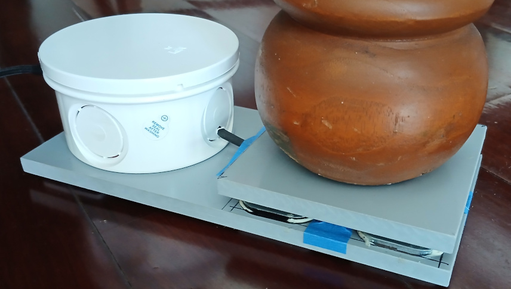

*For technical deployment, wiring diagrams, and source code setup, please refer to the [Technical README](./README_Patient-out-f-bed-alarm.md).*

---
# Smart Patient Bed-Exit Alarm System: Clinical Overview

## Executive Summary

The **Smart Patient Bed-Exit Alarm System** is an IoT-enabled, real-time occupancy and egress monitoring solution designed to enhance patient safety in hospitals, long-term care facilities, and home-care environments. By continuously monitoring bed occupancy via discrete load-cell sensors placed under the bed frame, the system provides immediate alerts when a fall-risk patient attempts to exit the bed unassisted, allowing care staff to intervene proactively.

---

---

## Key Clinical Features & Benefits

* **Immediate Fall-Risk Mitigation:** Instantly detects when a patient’s bed or chair weight drops below a safe occupancy threshold, triggering immediate local and network-wide alerts before a fall can occur.
* **Multi-Station Notification Versatility:** Unlike standalone alarms that can only be heard in a single room, this system can simultaneously broadcast critical alerts to multiple supervisory nodes—including centralized nurse station dashboards, mobile caregiver apps, and hallway smart displays.
* **Elimination of False/Delayed Alarms:** Employs high-precision, non-blocking digital weight sampling to ensure continuous monitoring integrity without system lag or freezing.
* **High Reliability & Self-Recovery:** Features automatic network re-connection capabilities and persistent local storage. If a power outage or network drop occurs, the system automatically restores its configuration and re-establishes connectivity without requiring manual intervention.

---

## Operational Workflow

The system operates on two primary clinical states tailored to patient safety protocols:

1. **Patient Occupied (In Bed):**
* When weight meets or exceeds the configured minimum threshold (`min_weight`), the system recognizes the bed as safely occupied.
* Optional status logs can quietly update nursing dashboards to confirm patient presence.

2. **Bed-Exit Detection (Critical Event):**
* The moment a patient attempts to exit and weight drops below the threshold, the system triggers a **critical alert cascade**.
* An audible local alarm activates immediately in the patient's room via an integrated buzzer or relay.
* Simultaneously, high-priority emergency alerts are dispatched across the local network to all registered caregiver supervisors (e.g., mobile units or central monitoring stations).

---

## System Configuration & Management

For care coordinators and facility administrators, the system supports straightforward remote or local configuration parameters to match individual patient care plans:

* **Unit Identification (`device_number`):** Assigns a unique room or bed identifier (00–99) so staff instantly know which bed requires attention.
* **Occupancy Threshold (`min_weight`):** Easily adjustable weight trigger (in kilograms) to accommodate different patient weights and prevent false alarms from lighter movements or bedding shifts.
* **Alarm Duration (`alarm_dur`):** Configures how long the local physical room alarm sounds upon an exit event.
* **Automatic Calibration (`cal` / Tare):** Automatically establishes a baseline tare offset upon power-up assuming an empty bed, ensuring accuracy over time.
